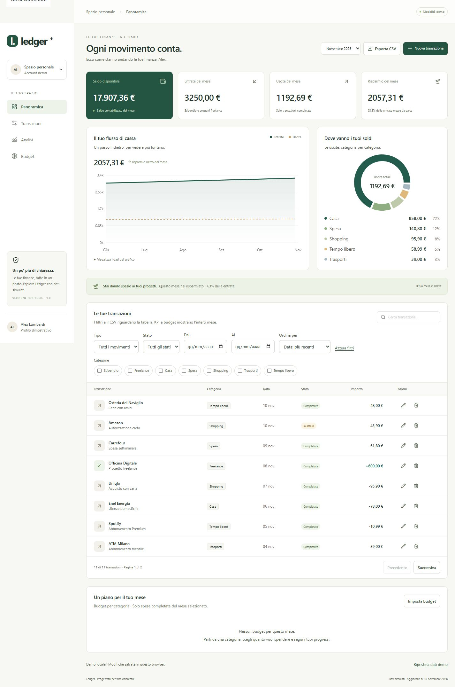

# Ledger

**A clearer view of your finances.** A responsive fintech dashboard for managing transactions, understanding spending, and tracking monthly budgets.

[Italiano](README.md) · **English**

A frontend portfolio project built with **React, TypeScript, and Tailwind CSS**. It combines a polished interface with practical engineering skills: state management, validated forms, data visualization, accurate monetary calculations, and user-flow testing.



## Features

- **Financial overview:** cumulative balance, monthly income, expenses, and net savings.
- **Interactive charts:** cash flow and spending by category, with a text alternative.
- **Transaction management:** create, edit, and delete transactions with validation and confirmation.
- **Search and filters:** multiple categories, transaction type, status, date range, sorting, and pagination. View settings are stored in the URL.
- **Monthly budgets:** category limits, remaining amounts, and indicators at the 80% and 100% thresholds.
- **Local persistence:** transactions and budgets survive page reloads.
- **CSV export:** all filtered transactions, including rows outside the current page.
- **Responsive layout:** desktop, tablet, and mobile, with keyboard navigation and visible focus.

## Tech stack

| Area                 | Technologies                                     |
| -------------------- | ------------------------------------------------ |
| UI                   | React 19, TypeScript, Tailwind CSS 4             |
| Build                | Vite 7                                           |
| Charts and icons     | Recharts, Lucide                                 |
| Forms and validation | React Hook Form, Zod                             |
| Testing              | Vitest, React Testing Library, user-event, jsdom |
| Quality              | Strict TypeScript, Prettier, GitHub Actions      |

## Getting started

**Requirements:** Node.js 24 and npm. From the project directory:

```bash
npm ci
npm run dev
```

Open the URL printed in your terminal, usually `http://127.0.0.1:5173`.

| Command              | Description                                            |
| -------------------- | ------------------------------------------------------ |
| `npm run dev`        | Start the development server                           |
| `npm run check`      | Run TypeScript checks, the production build, and tests |
| `npm test`           | Run all tests                                          |
| `npm run test:watch` | Run tests in watch mode                                |
| `npm run build`      | Generate the production build in `dist/`               |
| `npm run preview`    | Preview the production build locally                   |
| `npm run format`     | Format the source code                                 |

## Engineering decisions

**Monetary accuracy.** Amounts are stored as integer cents. Forms accept either a comma or a decimal point, with no implicit rounding. Pending transactions remain visible but are excluded from balance, expense, and budget calculations.

**Consistent financial summaries.** Metrics, charts, and budgets are derived from the selected month's transactions. Filters affect only the table and CSV export, preserving the full monthly overview.

**Architecture matched to the scope.** Local React state, focused components, and pure calculation functions keep the app understandable. No global state library or router is added without a concrete need. Persistence, filtering, validation, and export live in separate modules.

**Explicit error handling.** Invalid stored data, unavailable storage, incomplete forms, and empty search results have dedicated feedback. Native dialogs support Escape and focus restoration.

## Project structure

```text
src/
├── components/          Charts, table, forms, budgets, and dialogs
├── data/                Mock dataset and types
├── lib/                 Calculations, validation, filters, storage, CSV, and tests
├── App.tsx              Dashboard composition and state
├── App.test.tsx         User-flow integration tests
└── styles.css           Styling and responsive layout
docs/                    Screenshot and technical documentation
.github/workflows/       Build and test pipeline
```

## Verification

Version 1.0 was verified with **14 automated tests** covering financial calculations, amount parsing, persistence, filters, CSV, transaction management, and budgets. The production build completed successfully.

Manual browser checks covered persistence after reload, CSV export, dialogs, and layouts at **360, 768, and 1440 px**. React tests run in jsdom; an automated E2E suite is not yet included. No full WCAG conformance is claimed.

[Verification report, in Italian](VERIFICATION.md) · [Technical documentation, in Italian](docs/TECHNICAL.it.md)

## Demo scope

- Italian interface, EUR currency, entirely simulated data. This English README does not imply an English app interface.
- Fixed period: **June 1 – November 10, 2026**; November is a partial month. Forms accept dates within this range.
- Browser-only `localStorage` persistence, with no cross-device or cross-tab synchronization.
- Shared URLs preserve filters, not data. CSV exports exclude budgets and cannot be imported back.
- No backend, authentication, bank connection, or real financial operations.

## Roadmap

- [ ] Playwright E2E tests and browser-based accessibility auditing.
- [ ] Full data import/export and cross-tab synchronization.
- [ ] Dynamic reporting periods and a larger dataset.
- [ ] API integration, asynchronous states, and authentication.
- [ ] Public demo on static hosting.

Deployment settings: build command `npm run build`, output directory `dist/`. Navigation uses anchors and query strings, so no internal-route rewrites are required.
