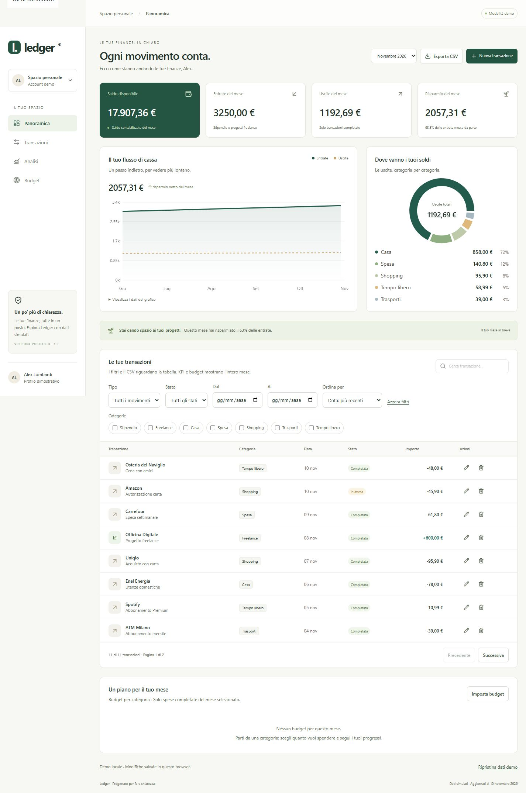

# Ledger

**Le tue finanze, in chiaro.** Una dashboard fintech responsive per gestire transazioni, analizzare le spese e monitorare i budget mensili.

**Italiano** · [English](README.en.md)

Progetto portfolio frontend realizzato con **React, TypeScript e Tailwind CSS**. L'obiettivo è mostrare un'interfaccia curata insieme a competenze concrete: gestione dello stato, form validati, visualizzazione dei dati, precisione monetaria e test dei flussi utente.



## Funzionalità

- **Dashboard finanziaria:** saldo cumulativo, entrate, uscite e risparmio del mese.
- **Grafici interattivi:** flusso di cassa e distribuzione delle spese per categoria, con alternativa testuale.
- **Gestione transazioni:** creazione, modifica ed eliminazione con conferma e validazione dei campi.
- **Ricerca e filtri:** categorie multiple, tipo, stato, intervallo date, ordinamento e paginazione. La vista è riproducibile tramite URL.
- **Budget mensili:** limiti per categoria, residuo e indicazioni delle soglie 80% e 100%.
- **Persistenza locale:** transazioni e budget restano disponibili dopo il ricaricamento.
- **Esportazione CSV:** tutte le transazioni filtrate, comprese quelle fuori dalla pagina corrente.
- **Layout responsive:** desktop, tablet e mobile, con navigazione da tastiera e focus visibile.

## Stack

| Area               | Tecnologie                                       |
| ------------------ | ------------------------------------------------ |
| Interfaccia        | React 19, TypeScript, Tailwind CSS 4             |
| Build              | Vite 7                                           |
| Grafici e icone    | Recharts, Lucide                                 |
| Form e validazione | React Hook Form, Zod                             |
| Test               | Vitest, React Testing Library, user-event, jsdom |
| Qualità            | TypeScript strict, Prettier, GitHub Actions      |

## Avvio locale

**Prerequisiti:** Node.js 24 e npm. Dalla cartella del progetto:

```bash
npm ci
npm run dev
```

Apri l'indirizzo mostrato nel terminale, normalmente `http://127.0.0.1:5173`.

| Comando              | Descrizione                               |
| -------------------- | ----------------------------------------- |
| `npm run dev`        | Avvia l'ambiente di sviluppo              |
| `npm run check`      | Esegue controllo TypeScript, build e test |
| `npm test`           | Esegue tutti i test                       |
| `npm run test:watch` | Esegue i test in modalità watch           |
| `npm run build`      | Genera la build di produzione in `dist/`  |
| `npm run preview`    | Mostra la build in locale                 |
| `npm run format`     | Formatta il codice                        |

## Scelte progettuali

**Precisione prima di tutto.** Gli importi sono memorizzati in centesimi interi. Il form accetta virgola o punto decimale, senza arrotondamenti impliciti. I movimenti in attesa restano visibili ma non entrano nei calcoli di saldo, spese e budget.

**Una fonte coerente per i riepiloghi.** KPI, grafici e budget derivano dalle transazioni del mese. I filtri modificano soltanto tabella e CSV, senza alterare il quadro finanziario generale.

**Architettura proporzionata al prodotto.** Stato React locale, componenti dedicati e funzioni pure per i calcoli. Nessuno store globale o router aggiunto senza necessità; persistenza, filtri, validazione ed export sono moduli indipendenti.

**Errori gestiti esplicitamente.** Dati locali non validi, scrittura non disponibile, form incompleti e ricerche senza risultati hanno messaggi dedicati. I dialog supportano Escape e il ripristino del focus.

## Struttura

```text
src/
├── components/          Grafici, tabella, form, budget e dialog
├── data/                Dataset simulato e tipi
├── lib/                 Calcoli, validazione, filtri, storage, CSV e test
├── App.tsx              Composizione e stato della dashboard
├── App.test.tsx         Test dei flussi utente
└── styles.css           Stili e layout responsive
docs/                    Anteprima e documentazione tecnica
.github/workflows/       Pipeline di build e test
```

## Verifica

La versione 1.0 è stata verificata con **14 test automatici**: calcoli finanziari, parsing degli importi, dati persistenti, filtri, CSV, gestione delle transazioni e budget. La build di produzione è stata eseguita con successo.

I controlli manuali nel browser coprono persistenza dopo reload, esportazione, dialog e layout a **360, 768 e 1440 px**. I test React usano jsdom; non è ancora inclusa una suite E2E automatizzata. Il progetto non dichiara una conformità WCAG completa.

[Rapporto di verifica](VERIFICATION.md) · [Documentazione tecnica](docs/TECHNICAL.it.md)

## Perimetro della demo

- Interfaccia in italiano, valuta EUR, dati interamente simulati.
- Periodo fisso: **1 giugno – 10 novembre 2026**; novembre è parziale. Il form accetta date entro questo intervallo.
- Dati salvati soltanto nel browser tramite `localStorage`, senza sincronizzazione tra dispositivi o schede.
- Il link conserva i filtri, non trasferisce i dati. Il CSV non include i budget e non è reimportabile.
- Nessun backend, autenticazione, collegamento bancario o operazione finanziaria reale.

## Evoluzioni previste

- [ ] Test E2E con Playwright e audit di accessibilità nel browser.
- [ ] Import/export completo dei dati e sincronizzazione tra schede.
- [ ] Periodi dinamici e dataset più ampio.
- [ ] API, gestione degli stati asincroni e autenticazione.
- [ ] Demo pubblica su hosting statico.

Per il deploy: comando `npm run build`, cartella di output `dist/`. La navigazione usa ancore e query string; non richiede riscritture per route interne.
